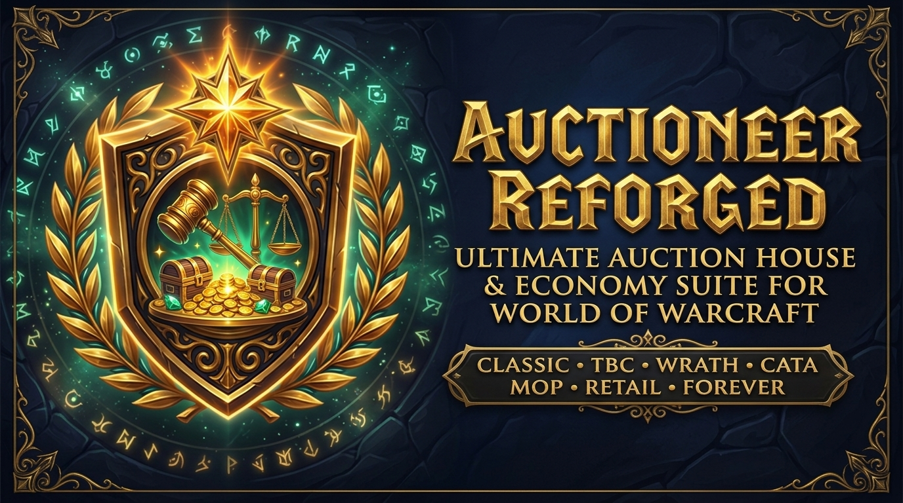

  

  # Auctioneer Reforged

  **The legendary *Auctioneer* suite — completely reforged and modernized for World of Warcraft!**

  
  
  
  
  
  
  
  

---

**Auctioneer Reforged** brings the iconic World of Warcraft Auction House & Economy suite back in a streamlined, modernized, and high-performance architecture across **WoW Forever**, **Retail / Midnight**, and all **Classic** flavors.

---

## 📦 Included Suite Components (5 Consolidated AddOn Folders)

| Folder | Description |
| :--- | :--- |
| **`Auc-Advanced`** | Core Auctioneer engine with embedded Stat modules (*Simple, StdDev, Histogram, Purchased, iLevel*), Basic Filter, and Utilities (*Appraiser, SearchUI, SimpleAuction, AutoMagic, ScanButton, PriceLevel, Glypher, AHWindowControl, FixAH*). |
| **`Auc-ScanData`** | Load-on-demand compressed Auction House scan snapshot storage and rope evaluator. |
| **`BeanCounter`** | Complete transaction history database for bids, buyouts, sales, postings, deposits, and mail invoices. |
| **`Enchantrix`** | Disenchanting, prospecting, and milling yield database & valuation engine + integrated **Enchantrix Barker** trade-channel broadcaster. |
| **`Informant`** | Detailed item tooltip database (vendor buy/sell prices, stack sizes, item levels, crafting usage, and quest/merchant sources). |

---

## ✨ Key Reforged Highlights

- 🖥️ **Modern Dark-Slate & Gold UI (`Configator.UIStyle`)**:
  - Crisp `1px` `WHITE8X8` borders, dark-slate backgrounds, and gold header accents matching *Gatherer Reforged*.
  - Modernized `Configator` settings panels with left-hand gold selection indicators, flat primary/secondary buttons, and gold-focused EditBoxes & MoneyFrames.
  - Zebra-striped `ScrollSheet` tables with dark-gold column headers and warm gold row selection across *SearchUI*, *Appraiser*, *SimpleAuction*, *BeanCounter*, and *AutoMagic*.
- 🏛️ **Retail `AuctionHouseFrame` & Classic `AuctionFrame` Integration**:
  - Seamless tab creation and circular-anchor-safe tab chaining on both Retail (`AuctionHouseFrame` via `AuctionHouseFrameMixin` template) and Classic (`AuctionFrame`) clients.
- ⚡ **Memory & Database Optimizations**:
  - **Modular Per-Language Localization (`Locales/<locale>.lua` + `Babylonian` v4)**: Split into 84 individual locale files with automatic `PLAYER_LOGIN` pruning of unused languages (~80% locale RAM reduction).
  - **Weak-Valued Price Caches (`{__mode="v"}`)**: Eliminates repeated string unpacking and prevents unbounded memory growth in `Auc-Stat-Simple` and `Auc-Stat-StdDev`.
  - **Automatic Stale Database Pruning**: Cleans empty `serverKey` and item tables on initialization.
- 🧹 **Zero Legacy Bloat**:
  - Completely removed `!Swatter`, `Stubby` (and its dynamic `loadstring` SavedVariables bootcode), `SlideBar`, `DebugLib`, and `LibRevision`.
  - Replaced with native `hooksecurefunc`, a lightweight native event/addon dispatcher, `LibDataBroker-1.1`, `LibDBIcon-1.0` minimap buttons, Retail Addon Compartment integration, and native `ESC -> Options -> AddOns` canvas categories.

---

## 🎮 Supported WoW Versions

- **WoW Forever** (`16001`)
- **Retail / Midnight** (`12.x`)
- **Mists of Pandaria Classic** (`5.5.x`)
- **Cataclysm Classic** (`4.4.x`) & **Wrath Classic** (`3.4.x` / `3.8.x`)
- **Burning Crusade Classic Anniversary** (`2.5.x`)
- **Classic Era** (`1.15.x`)

---

## ⌨️ Slash Commands

| Command | Description |
| :--- | :--- |
| `/auc` or `/auctioneer` | Open Auctioneer Reforged configuration & commands |
| `/auc about` | Print active modules and version information |
| `/beancounter` or `/bc` | Open BeanCounter transaction history & configuration |
| `/enchantrix` or `/enx` | Open Enchantrix configuration |
| `/barker` | Open Enchantrix Barker trade-chat broadcaster |
| `/informant` or `/inf` | Open Informant configuration |

---

## 📜 Credits & License

- **Original Suite**: Norganna's AddOns
- **Author (Reforged Modernization)**: **gOOvER** ([goover.dev](https://www.goover.dev))
- **License**: [GNU General Public License v3.0 (GPL-3.0)](LICENSE)
- **Support Development**: [donate.goover.dev](https://donate.goover.dev) • [Ko-fi](https://ko-fi.com/oldnoob) • [Buy Me a Coffee](https://www.buymeacoffee.com/goover)

---

## 🐛 Bug Reports & Feedback

Found a bug or have a feature request? Please report it on the **[GitHub Issue Tracker](https://github.com/gOOvER/AuctioneerReforged/issues)** (please include your WoW client version, addon version, and any Lua errors if available).
